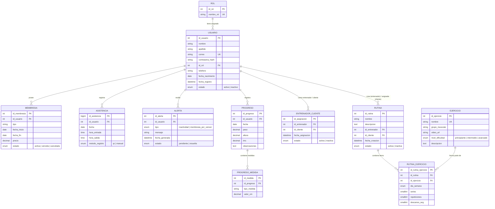

# 📘 Documentación Integral del Backend — ApexFit API

> **Sistema de Gestión Integral para Gimnasios y Centros de Entrenamiento Deportivo**  
> **Framework:** Spring Boot 4.x / Java 17  
> **Seguridad:** Spring Security 6 & JWT (Stateless) con RBAC  
> **Persistencia:** Spring Data JPA / Hibernate & MySQL (Local y AWS RDS)  
> **Migraciones:** Flyway DB Migration  

---

## 📑 Tabla de Contenidos
1. [Visión General y Propósito del Sistema](#1-visión-general-y-propósito-del-sistema)
2. [Arquitectura de Software (Layered Architecture)](#2-arquitectura-de-software-layered-architecture)
3. [Stack Tecnológico y Dependencias](#3-stack-tecnológico-y-dependencias)
4. [Modelo de Base de Datos y Persistencia](#4-modelo-de-base-de-datos-y-persistencia)
5. [Seguridad, Autenticación y Autorización (RBAC)](#5-seguridad-autenticación-y-autorización-rbac)
6. [Catálogo Detallado de Módulos y Lógica de Negocio](#6-catálogo-detallado-de-módulos-y-lógica-de-negocio)
7. [Manejo Centralizado de Excepciones y Validaciones](#7-manejo-centralizado-de-excepciones-y-validaciones)
8. [Configuración de Entornos y Despliegue](#8-configuración-de-entornos-y-despliegue)
9. [Estrategia de Pruebas Automatizadas (Postman / Newman)](#9-estrategia-de-pruebas-automatizadas-postman--newman)

---

## 1. Visión General y Propósito del Sistema

**ApexFit Backend** es una API RESTful desarrollada con **Spring Boot** y **Java 17** que centraliza y automatiza toda la operativa comercial, deportiva y administrativa de un gimnasio moderno.

### Objetivos Principales:
- **Gestión Integral de Usuarios:** Administración de tres tipos de actores clave (Administradores, Entrenadores y Clientes).
- **Control de Acceso y Asistencias Inteligente:** Registro rápido y validado mediante **códigos QR** dinámicos y método manual.
- **Entrenamiento Personalizado:** Planificación de rutinas, catálogo de ejercicios clasificados por grupos musculares y dificultad, y asignación de entrenadores a clientes.
- **Control Financiero y Membresías:** Seguimiento del ciclo de vida de planes de membresía (activa, vencida, cancelada).
- **Seguimiento Antropométrico:** Registro de evolución física (peso, altura, cálculo de IMC) y medidas corporales detalladas en centímetros.
- **Inteligencia de Negocio:** Tablero de control (`Dashboard`) en tiempo real con estadísticas de concurrencia y miembros activos.

---

## 2. Arquitectura de Software (Layered Architecture)

El backend sigue rigurosamente el **patrón arquitectónico en capas (Layered Architecture)**, asegurando alta cohesión, bajo acoplamiento y separación de responsabilidades:

```
[ Petición HTTP / Cliente Web / Móvil ]
                 │
                 ▼
      ┌─────────────────────┐
      │  Security Filter    │ ◄── AuthTokenFilter (Valida JWT en cabecera)
      └──────────┬──────────┘
                 │
                 ▼
      ┌─────────────────────┐
      │  Controller Layer   │ ◄── Rutas REST, @PreAuthorize, DTOs de entrada/salida
      └──────────┬──────────┘
                 │
                 ▼
      ┌─────────────────────┐
      │    Service Layer    │ ◄── Lógica de negocio, @Transactional, transformaciones
      └──────────┬──────────┘
                 │
                 ▼
      ┌─────────────────────┐
      │  Repository Layer   │ ◄── Spring Data JPA / Queries derivadas
      └──────────┬──────────┘
                 │
                 ▼
      ┌─────────────────────┐
      │  Database (MySQL)   │ ◄── Tablas relacionales con Flyway Migrations
      └─────────────────────┘
```

### Componentes de Cada Capa:
1. **Capa de Controladores (`com.apexfit.backend.controller`):**
   - Expone los endpoints HTTP bajo la convención RESTful `/api/v1/*`.
   - Aplica validaciones sintácticas con Bean Validation (`@Valid`).
   - Aplica seguridad declarativa mediante `@PreAuthorize("hasRole(...)")`.
2. **Capa de Servicios (`com.apexfit.backend.service`):**
   - Orquesta la lógica del negocio.
   - Maneja la demarcación de transacciones con `@Transactional(readOnly = true)` para lecturas eficientes y `@Transactional` para mutaciones de datos.
   - Aplica transformaciones entre entidades JPA y DTOs (Data Transfer Objects).
3. **Capa de Repositorios (`com.apexfit.backend.repository`):**
   - Interfaces que extienden `JpaRepository<Entity, ID>`.
   - Proporcionan métodos CRUD automáticos, paginación (`Pageable`) y consultas derivadas optimizadas (ej. `countByFecha`, `findByUsuario_IdUsuarioOrderByFechaDesc`).
4. **Capa de Entidades (`com.apexfit.backend.entity`):**
   - Clases anotadas con JPA/Hibernate que mapean directamente las tablas de la base de datos MySQL.
5. **Capa de Transferencia de Datos (`com.apexfit.backend.dto`):**
   - Objetos planos que aíslan el modelo de base de datos de las respuestas y peticiones expuestas a clientes externos.

---

## 3. Stack Tecnológico y Dependencias

Definidas en el archivo `pom.xml`:

| Tecnología / Dependencia | Versión | Rol en el Proyecto |
|---|---|---|
| **Java** | 17 LTS | Lenguaje de programación principal |
| **Spring Boot Starter Parent** | 4.1.1 | Framework base de la aplicación |
| **Spring Boot Starter WebMvc** | — | Soporte para controladores REST y APIs JSON |
| **Spring Boot Starter Security** | — | Motor de autenticación y autorización |
| **Spring Boot Starter Data JPA** | — | ORM y abstracción de persistencia relacional con Hibernate |
| **Spring Boot Starter Validation** | — | Validaciones declarativas (`@NotBlank`, `@Email`, `@Min`, etc.) |
| **JJWT (`io.jsonwebtoken`)** | 0.11.5 | Generación, firma digital HMAC-SHA256 y parseo de tokens JWT |
| **MySQL Connector/J** | 9.x | Driver JDBC para comunicación con base de datos MySQL |
| **Flyway Core & MySQL** | — | Versionamiento y migración automática del esquema DDL |
| **Project Lombok** | — | Generación en tiempo de compilación de getters, setters, constructores y builders |

---

## 4. Modelo de Base de Datos y Persistencia

El esquema relacional cuenta con **11 tablas**, versionadas mediante **Flyway Migrations** ubicadas en `src/main/resources/db/migration/`:
- `V1__Initial_schema.sql`: Creación de tablas, claves foráneas, restricciones y roles base (`cliente`, `entrenador`, `administrador`).
- `V2__add_indexes.sql`: Creación de índices estratégicos en columnas de alta consulta (`grupo_muscular`, `id_cliente`, `id_entrenador`, `estado`).

### Diagrama Entidad-Relación (MER):



---

## 5. Seguridad, Autenticación y Autorización (RBAC)

La seguridad está implementada en `com.apexfit.backend.security` y configurada en `WebSecurityConfig.java`:

### 5.1. Arquitectura Stateless con JWT
- **Sesión Sin Estado (`SessionCreationPolicy.STATELESS`):** El servidor no almacena cookies ni sesiones de sesión en memoria. Toda la identidad del usuario viaja en el token en cada petición.
- **Protección CSRF:** Deshabilitada intencionalmente (`csrf.disable()`) al no depender de cookies de navegación.
- **Filtro de Interceptación (`AuthTokenFilter`):** Intercepta cada solicitud entrante, extrae el encabezado `Authorization: Bearer <token>`, valida la firma digital y establece la autenticación en el `SecurityContextHolder`.

### 5.2. Algoritmo y Ciclo de Vida del Token (`JwtUtils.java`)
- **Algoritmo:** HMAC-SHA256 (`HS256`) con clave simétrica secreta de al menos 256 bits (`apexfit.app.jwtSecret`).
- **Tiempo de Expiración:** 24 horas (`86,400,000 ms`).
- **Claims:** El *Subject* almacena el correo electrónico único del usuario.

### 5.3. Modelo RBAC (Role-Based Access Control)
Spring Security transforma los roles almacenados en la base de datos (por ejemplo, `administrador`, `entrenador`, `cliente`) agregándoles el prefijo estándar `ROLE_` en `UserDetailsServiceImpl` / `UserDetailsImpl`:
- `ROLE_ADMINISTRADOR`
- `ROLE_ENTRENADOR`
- `ROLE_CLIENTE`

### 5.4. Matriz de Autorización por Controlador

| Módulo / Controlador | Roles Permitidos de Lectura (`GET`) | Roles Permitidos de Escritura (`POST`, `PUT`, `DELETE`) |
|---|---|---|
| **`/api/v1/auth/**`** | Público (todos) | Público (todos) |
| **`/api/v1/usuarios`** | `ADMINISTRADOR`, `ENTRENADOR` (todos); Cualquier rol autenticado (`/perfil`, `/cambiar-password`) | Crear / Borrar: `ADMINISTRADOR`. Actualizar: Todos sobre su perfil |
| **`/api/v1/dashboard/**`** | `ADMINISTRADOR`, `ENTRENADOR` | *No aplica (sólo consulta)* |
| **`/api/v1/membresias`** | `ADMINISTRADOR`, `ENTRENADOR`, `CLIENTE` (sólo propias) | Crear: `ADMINISTRADOR`, `ENTRENADOR`. Modificar/Borrar: `ADMINISTRADOR` |
| **`/api/v1/asistencias`** | `ADMINISTRADOR`, `ENTRENADOR`, `CLIENTE` (propias) | Registrar asistencia (manual / QR): `CLIENTE`, `ADMINISTRADOR`, `ENTRENADOR`. Modificar / Borrar: `ADMINISTRADOR` |
| **`/api/v1/ejercicios`** | `CLIENTE`, `ENTRENADOR`, `ADMINISTRADOR` | Crear / Modificar / Borrar: `ENTRENADOR`, `ADMINISTRADOR` |
| **`/api/v1/rutinas`** | `CLIENTE` (propias), `ENTRENADOR`, `ADMINISTRADOR` | Crear / Modificar / Borrar: `ENTRENADOR`, `ADMINISTRADOR` |
| **`/api/v1/rutina-ejercicios`** | `CLIENTE`, `ENTRENADOR`, `ADMINISTRADOR` | `ENTRENADOR`, `ADMINISTRADOR` |
| **`/api/v1/progresos`** | `CLIENTE` (propios), `ENTRENADOR`, `ADMINISTRADOR` | Crear/Editar: `CLIENTE`, `ENTRENADOR`, `ADMINISTRADOR`. Borrar: `ADMINISTRADOR`, `ENTRENADOR` |
| **`/api/v1/alertas`** | `CLIENTE` (propias), `ENTRENADOR`, `ADMINISTRADOR` | Crear/Editar: `ENTRENADOR`, `ADMINISTRADOR`. Borrar: `ADMINISTRADOR` |
| **`/api/v1/entrenador-cliente`** | Consultas: `ADMINISTRADOR`, `ENTRENADOR`, `CLIENTE` | Asignar / Desasignar: `ADMINISTRADOR` |

---

## 6. Catálogo Detallado de Módulos y Lógica de Negocio

### 6.1. Módulo de Autenticación (`AuthController`)
- **`POST /api/v1/auth/login`**: Valida credenciales (`correo`, `contrasena`) contra la base de datos usando `AuthenticationManager` y BCrypt. Devuelve el JWT, ID de usuario, correo y listado de roles con prefijo `ROLE_`.
- **`POST /api/v1/auth/register`**: Permite autoregistro de usuarios. Si no se especifica rol, se asigna automáticamente el rol `cliente`. La contraseña se hashea con `BCryptPasswordEncoder` antes de persistirse.
- **`POST /api/v1/auth/solicitar-recuperacion`**: Permite a un usuario solicitar el restablecimiento de su contraseña enviando su correo (`RecuperarPasswordRequest`). Valida que el usuario exista y esté activo, y genera un token JWT temporal y firmado criptográficamente con vigencia de 15 minutos (`purpose: "PASSWORD_RESET"`).
- **`POST /api/v1/auth/resetear-password`**: Recibe el token temporal de recuperación y la nueva contraseña (`ResetearPasswordRequest`). Valida la integridad y caducidad del token, actualiza la contraseña codificada con BCrypt y guarda los cambios sin comprometer la seguridad de la sesión.

### 6.2. Módulo de Usuarios (`UsuarioController` y `UsuarioService`)
- **Paginación nativa:** Soporta `Pageable` para consultas eficientes en listados masivos.
- **Borrado Lógico (*Soft Delete*):** La eliminación (`DELETE /api/v1/usuarios/{id}`) no destruye físicamente la tupla de la BD; cambia el campo `estado` a `'inactivo'`, preservando la integridad referencial histórica de membresías, asistencias y pagos.
- **Seguridad en Cambio de Contraseña:** `PUT /api/v1/usuarios/cambiar-password` exige ingresar la contraseña actual antes de actualizar a la nueva contraseña codificada.
- **Endpoint `/perfil`:** Resuelve automáticamente los datos del usuario actual tomando el correo del token autenticado (`Authentication.getName()`).

### 6.3. Módulo de Asistencias y Lector QR (`AsistenciaController` y `AsistenciaService`)
- **Registro Inteligente por QR (`POST /api/v1/asistencias/escanear-qr`):**
  - Admite el formato estructurado de credencial móvil: `APEXFIT-USER-{id}-{correo}`.
  - Admite el ID numérico directo: `{id}`.
  - Admite el correo electrónico en texto plano.
  - Genera automáticamente la tupla de asistencia con fecha actual (`LocalDate.now()`), hora de entrada (`LocalTime.now()`) y método `'QR'`.
- **Auditoría de Entrada y Salida:** Soporta registrar o actualizar la hora de salida para calcular tiempo de permanencia.

### 6.4. Módulo de Dashboard y KPIs (`DashboardController` y `DashboardService`)
Calcula en una sola llamada agregada (`GET /api/v1/dashboard/resumen`):
- Total de usuarios registrados.
- Total de clientes con estado `activo`.
- Total de entrenadores disponibles.
- Membresías con estado `activa`.
- Concurrencia de asistencias registradas en la fecha actual (`LocalDate.now()`).
- Total de ejercicios y rutinas creadas.
- Agrupación estadística de asistencias por método (`QR` vs `manual`).

### 6.5. Módulo de Rutinas y Ejercicios
- **`EjercicioService`:** Permite filtrar ejercicios por grupo muscular (e.g., Pecho, Espalda, Pierna) y nivel de dificultad (principiante, intermedio, avanzado), incluyendo URLs a videos demostrativos y descripción detallada.
- **`RutinaService` y `RutinaEjercicioService`:** Modelan la planificación de entrenamiento semanal vinculando ejercicios con número de series, repeticiones y tiempo de descanso en segundos asignados a un cliente por un entrenador.

### 6.6. Módulo de Progreso Antropométrico
- **`ProgresoService`:** Registra pesajes periódicos, altura e índice de masa corporal (IMC).
- **Relación en Cascada:** Al crear un progreso, permite adjuntar opcionalmente en el mismo payload las medidas corporales (`tipoMedida`: cintura, bíceps, pecho, etc., con su valor numérico en cm).

### 6.7. Módulo de Membresías y Alertas
- **`MembresiaService`:** Gestiona tipos de suscripción, fechas de vigencia y montos cobrados.
- **`AlertaService`:** Canal de comunicación para advertir sobre clientes inactivos (riesgo de deserción) o membresías próximas a expirar.

---

## 7. Manejo Centralizado de Excepciones y Validaciones

Anotado con `@ControllerAdvice`, la clase `GlobalExceptionHandler.java` intercepta todos los errores producidos en los controladores y devuelve un esquema JSON unificado `ErrorResponse`:

```json
{
  "timestamp": "2026-10-19T18:45:00",
  "status": 400,
  "error": "Validation Error",
  "message": "Uno o más campos tienen errores de validación",
  "validationErrors": {
    "correo": "El formato del correo es inválido",
    "contrasena": "La contraseña debe tener al menos 6 caracteres"
  }
}
```

### Excepciones Manejadas:
1. `ResourceNotFoundException`: Devuelve código `404 Not Found` cuando una entidad buscada por ID o parámetro no existe.
2. `MethodArgumentNotValidException`: Devuelve código `400 Bad Request` con un mapa clave-valor de todos los errores sintácticos detectados por `@Valid`.
3. `AccessDeniedException`: Devuelve código `403 Forbidden` cuando el usuario autenticado carece de los roles requeridos en `@PreAuthorize`.
4. `BadCredentialsException`: Devuelve código `401 Unauthorized` cuando el correo o contraseña son incorrectos en el login.
5. `DisabledException`: Devuelve código `403 Forbidden` informando que la cuenta ha sido dada de baja (`inactiva`).
6. `RuntimeException` y errores generales: Devuelve código `400 Bad Request` con el mensaje controlado de la excepción.

---

## 8. Configuración de Entornos y Despliegue

La configuración del proyecto utiliza archivos YAML en `src/main/resources/`:

### 8.1. Perfil de Desarrollo (`dev`) — `application-dev.yml`
Diseñado para ejecución local en máquina de desarrollo:
```yaml
spring:
  datasource:
    url: jdbc:mysql://${DB_HOST:localhost}:${DB_PORT:3306}/${DB_NAME:apexfit}?useSSL=false&serverTimezone=UTC&createDatabaseIfNotExist=true
    username: ${DB_USER:root}
    password: ${DB_PASS:root}
  jpa:
    show-sql: true
```

### 8.2. Perfil de Producción (`prod`) — `application-prod.yml`
Diseñado para despliegue en la nube conectando a **AWS RDS (Relational Database Service)**:
```yaml
spring:
  datasource:
    url: jdbc:mysql://${RDS_HOSTNAME}:${RDS_PORT:3306}/${RDS_DB_NAME}?useSSL=true&requireSSL=false&serverTimezone=UTC
    username: ${RDS_USERNAME}
    password: ${RDS_PASSWORD}
```

### 8.3. Comandos de Ejecución

**En Desarrollo Local:**
```bash
# Desde la carpeta /apexfit-backend/backend
./mvnw spring-boot:run
```

**En Producción (con AWS RDS):**
```bash
# En Windows PowerShell
$env:APP_PROFILE="prod"
$env:RDS_HOSTNAME="apexfit-mysql.cxxxxxx.us-east-1.rds.amazonaws.com"
$env:RDS_DB_NAME="apexfit"
$env:RDS_USERNAME="admin"
$env:RDS_PASSWORD="TuPasswordSeguro"
./mvnw spring-boot:run
```

---

## 9. Estrategia de Pruebas Automatizadas (Postman / Newman)

El backend cuenta con una suite completa de pruebas de regresión y seguridad automatizadas:
- **Colección Postman:** [`postman/collections/ApexFit_JWT_Security.postman_collection.json`](../../postman/collections/ApexFit_JWT_Security.postman_collection.json).
- **Cobertura:** **47 pruebas automatizadas** que validan:
  - Generación y estructura de tokens JWT.
  - Validación de roles RBAC: Intentos de acceso denegado (`403 Forbidden`) y permitido (`200 OK` / `201 Created`).
  - Pruebas de integración de todo el flujo de asistencias QR.
  - Auditoría de CRUD de todos los controladores.
- **Runner de Consola:** Script PowerShell automatizado [`run_postman_tests.ps1`](../../run_postman_tests.ps1) para ejecutar la suite completa en pipelines CI/CD vía **Newman**.
